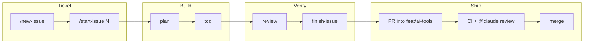

# How I work with Claude (developer playbook)

I use Claude to turn a ticket into a reviewed pull request in small, checkable steps. I keep the decisions that can't be undone for myself: commits, pushes and merges.

## My loop, ticket to shipped



Names with a slash are commands. The others are skills. One issue is one branch is one PR, so every step has a single thing to point at.

## Workflows I lean on

| Skill          | I reach for it when                                                                                                              |
| -------------- | -------------------------------------------------------------------------------------------------------------------------------- |
| `grill`        | The ask is vague and I'd otherwise let Claude guess. It asks me the open decisions first.                                        |
| `plan`         | A change touches three or more files. I get small, verifiable steps before any edit.                                             |
| `tdd`          | A bug can be reproduced by a test. Red first, then the smallest fix.                                                             |
| `debug`        | Something fails and the cause is unknown. Root cause before any patch.                                                           |
| `review`       | The work is done and nothing is committed. It checks correctness, standards, tests, security, scope and the issue spec.          |
| `finish-issue` | The issue is complete. It runs the five checks, updates `docs/issues` and prints the commit, push and PR commands for me to run. |

## Prompts I reuse, and what they trigger

Skills load when Claude matches my wording to a skill's description, so the lines below are what I expect, not a guarantee. I can also call a skill by name.

### Start from the spec

```text
Read docs/issues/NN-*.md and list the acceptance criteria as a checklist. For each one, name the file where it will be implemented and the test that proves it. Do not edit anything yet.
```

Use at the start of an issue, before any code.

- **Skills:** `plan` may load, because the work will span several files. `grill` loads if the spec leaves decisions open.
- **Result:** A checklist mapping each criterion to a file and a test. No files change.

### Attack my own diff

```text
Review my uncommitted changes as a skeptical teammate. Look for input the data source can omit, empty and boundary cases, and anything the issue spec requires that the diff does not cover. Report findings only; do not fix them.
```

Use before handing over to a human reviewer. It tends to catch edge cases, such as a field the API can omit or items that are skipped but still counted.

- **Skills:** `review`, which runs the `repo-reviewer` agent over the uncommitted and untracked files.
- **Result:** A findings report split into must-fix and judgement calls. My "report only" line keeps Claude from editing before I read it.

### Explain before changing

```text
Before you change anything, explain how this code path works today and which tests cover it. Then propose the smallest change and say what could break.
```

Use on code I did not write, or when this Next.js version behaves differently than I expect.

- **Skills:** `next-docs` when the code is Next.js, so the answer comes from the bundled docs for this version. `how-we-write-tests` if tests are involved.
- **Result:** An explanation, the smallest proposed change and its risks, before any edit.

### Prove it

```text
Run lint, typecheck, format:check, build and test. Report what passed and what failed. If you could not run something, say "not verified" and why.
```

Use before I trust any "done".

- **Skills:** None. It runs the five commands from `package.json` directly. `finish-issue` does the same plus the review when the whole issue is done.
- **Result:** A pass or fail line per command, and "not verified" with a reason for anything that did not run.

## Guardrails I keep

- **Never commit or push on its own.** Claude hands me the commands. I read the diff, then I run them.
- **Never read or print secrets.** `.env` files, keys and credentials stay out of the session and out of logs.
- **Ask first for destructive commands and new dependencies.** Anything that deletes data or changes `package.json` needs my yes.
- **Always review before handoff.** The review skill runs after code changes and before I see commit commands.
- **Always say "not verified".** A check that did not run is reported as not run, never implied to pass.
- **One issue, one change.** Side problems become follow-up notes instead of surprise edits in the PR.

## What I would standardize next

1. Add the recurring review findings (omitted API fields, skipped items, cache edge cases) to the review checklist, so they are caught before a human looks.
2. Trim the end-of-turn hooks if typecheck and lint slow down small edits, and keep only what has caught real problems.
3. Tie each acceptance criterion in `docs/issues` to a named test, so the BA check after merge is quick.

Rules: `.claude/rules` · Skills: `.claude/skills` · Checks: `pnpm lint`, `typecheck`, `format:check`, `build`, `test`
