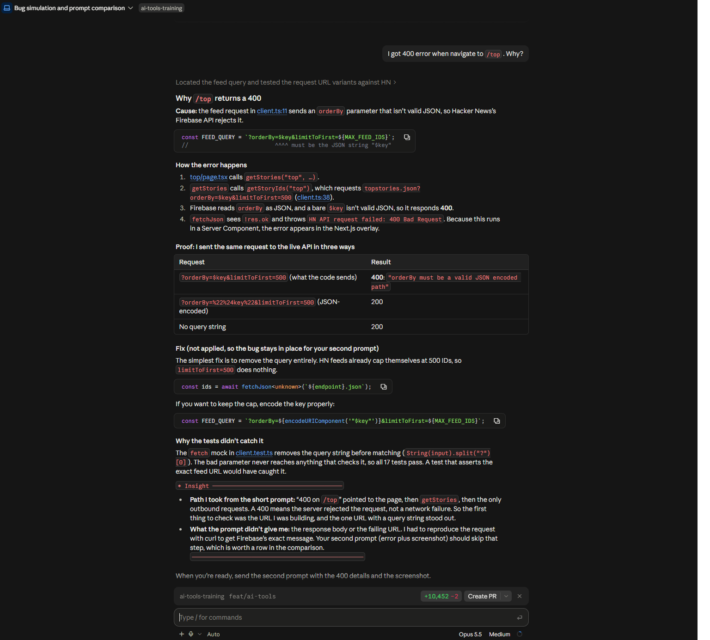
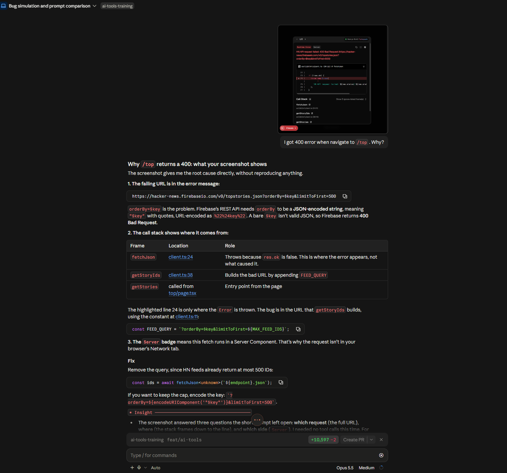

# Bug simulation: vague prompt vs. prompt with evidence

Date: 2026-10-12 · Branch: `feat/ai-tools` (uncommitted simulation)

## The simulated bug

- **Change:** `getStoryIds` appends `FEED_QUERY = ?orderBy=$key&limitToFirst=500` to the feed URL (`src/lib/hn/client.ts:11`, used at `:38`).
- **Root cause:** Firebase needs `orderBy` to be a JSON-encoded string (`"$key"` → `%22%24key%22`). A bare `$key` gets **400** with `"orderBy must be a valid JSON encoded path"`.
- **How it was hidden:** the `fetch` mock in `client.test.ts` drops the query string before matching, so all 17 tests pass. Typecheck and lint pass too.
- **How it surfaces:** the temporary page `src/app/top/page.tsx` calls `getStories("top")`. Opening `/top` shows a Next.js **Server** runtime error.

## The two prompts

|                   | Prompt 1 (simple)                               | Prompt 2 (with evidence)                                                                                                                  |
| ----------------- | ----------------------------------------------- | ----------------------------------------------------------------------------------------------------------------------------------------- |
| Text              | "I got 400 error when navigate to `/top`. Why?" | Same text, plus a screenshot of the Next.js error overlay                                                                                 |
| Evidence attached | None                                            | Error message with full failing URL, `Server` badge, code frame (`client.ts:24`), call stack (`fetchJson` → `getStoryIds` → `getStories`) |

## Results comparison

| Criterion                                                           | Prompt 1: simple                                                                                   | Prompt 2: 400 + screenshot                                                                                                 |
| ------------------------------------------------------------------- | -------------------------------------------------------------------------------------------------- | -------------------------------------------------------------------------------------------------------------------------- |
| Root cause found                                                    | ✅ `orderBy=$key` isn't JSON-encoded                                                               | ✅ Same                                                                                                                    |
| Tool calls needed                                                   | 1 (grep for the query constant + 3 curl reproductions against the live API)                        | **0**, read straight from the screenshot                                                                                   |
| How the failing request was found                                   | Inferred: traced page → `getStories` → `getStoryIds` and picked the only URL with a query string   | Read directly from the error message                                                                                       |
| Exact failing URL                                                   | Had to rebuild it from code                                                                        | Given in the overlay                                                                                                       |
| Code location                                                       | Found by searching (`client.ts:11`, `:38`)                                                         | Given by the stack (`client.ts:24` → `:38`). Still had to tell the throw site (`:24`) apart from the cause (`:38` / `:11`) |
| Server vs. client                                                   | Inferred from the page being an async Server Component                                             | Explicit `Server` badge                                                                                                    |
| Firebase error body (`"orderBy must be a valid JSON encoded path"`) | ✅ Got it, from the curl reproduction                                                              | ❌ Not in the screenshot (`fetchJson` drops the body), so I had to rely on knowing Firebase                                |
| Proof the fix works                                                 | ✅ Ran it: JSON-encoded `orderBy` → 200, no query → 200                                            | Not re-run (already shown for prompt 1)                                                                                    |
| Risk of a wrong diagnosis                                           | Medium: a 400 on a page could also come from a route handler, middleware, a bad item ID, and so on | Low: the URL and stack point to one cause                                                                                  |
| Explained why tests missed it                                       | ✅ Mock removes the query string                                                                   | Not covered (the screenshot is about runtime only)                                                                         |
| Answer length / effort                                              | Longer: investigation trail plus proof table                                                       | Shorter: read the evidence, then point to the line                                                                         |

## Evidence

### Prompt 1: simple prompt

The assistant traced the code and reproduced the request against the live API (three URL variants) to confirm the root cause.



### Prompt 2: 400 error + screenshot

The assistant read the failing URL, the `Server` badge and the call stack straight from the attached overlay screenshot, with no tool calls.



## Caveat on fairness

The same session planted the bug and then diagnosed it, so the assistant already knew the root cause for **both** prompts. The tool-call counts and how direct the answers were are therefore **lower bounds** for prompt 1. A developer or agent seeing the bug for the first time, with only the vague prompt, would have had to search more widely: other routes, middleware, network tab, server logs. The evidence-based prompt doesn't depend much on prior knowledge, because the overlay alone points to the cause.

## Takeaways

1. **Error text + URL + stack trace remove most of the search.** The screenshot answered _which request_, _where_, and _server or client_ before any code was opened.
2. **A screenshot isn't a complete bug report.** It missed the server's response body. Paste the error text as text too, along with the response body or the server log line if you have them.
3. **For server-side fetches, the browser Network tab shows nothing.** Evidence has to come from the dev overlay or the `pnpm dev` terminal.
4. **Code improvement suggested by this exercise:** include the response body in `fetchJson`'s error, so that a 400 explains itself.

## Cleanup

```bash
git checkout -- src/lib/hn/client.ts src/lib/hn/client.test.ts
git clean -f src/app/top/page.tsx
```
